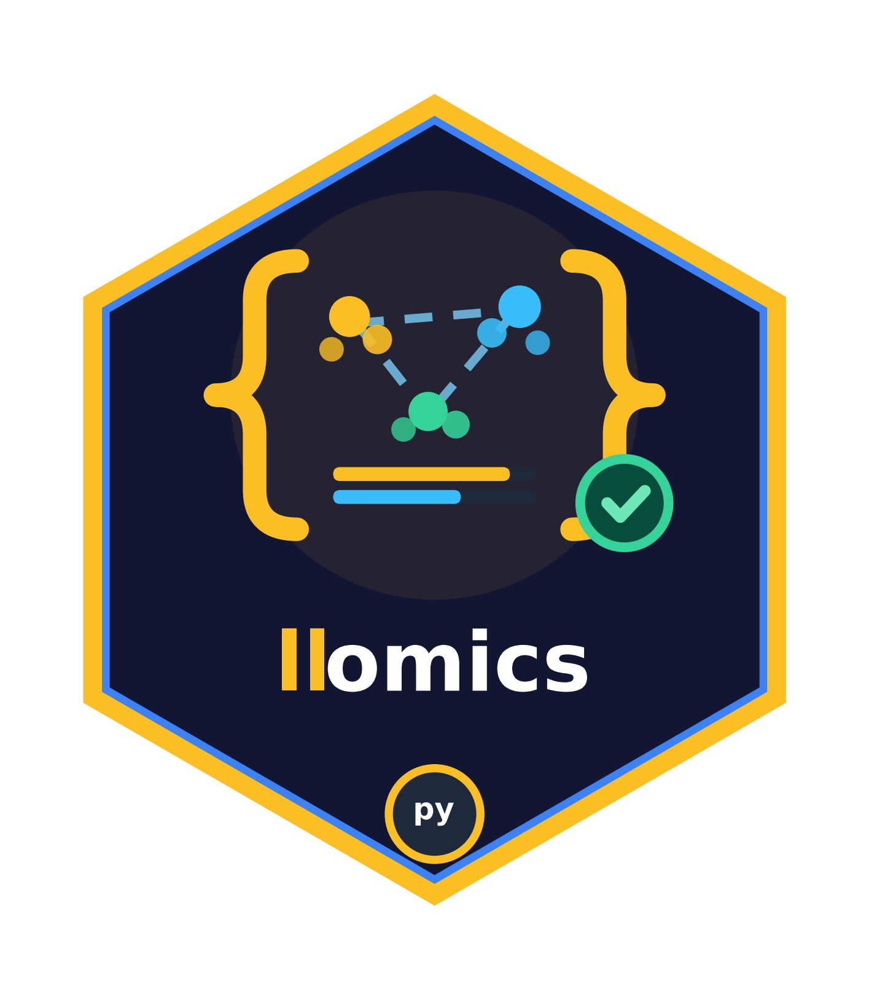
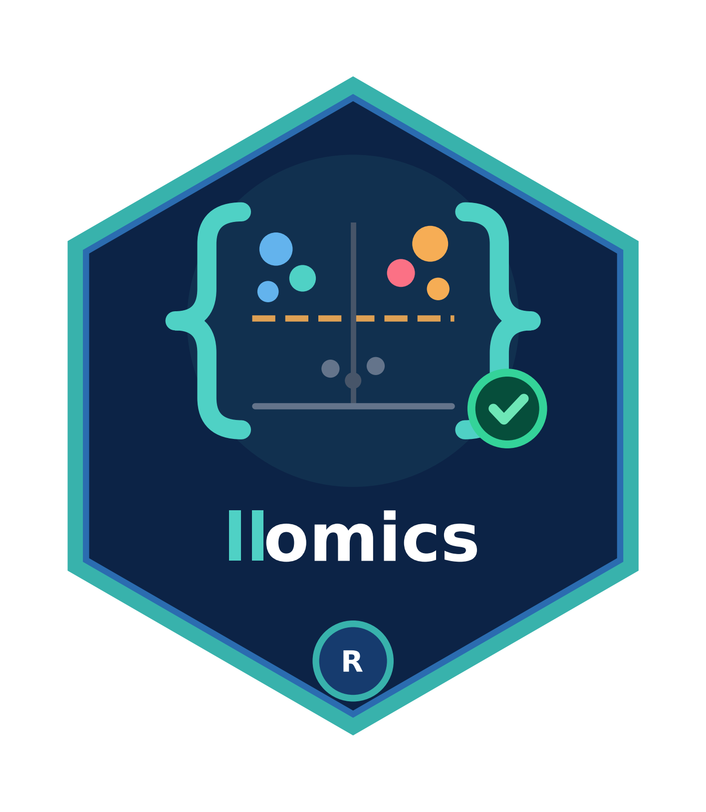

# llomics

<p align="center">
  
  
</p>

Turn the output of statistical steps in omics pipelines into small, self-describing payloads that
an LLM can reason over, and decide in code what the answers are allowed to settle.

A single script run can produce a 20,000-row differential expression table or a marker table for
every cluster. No person reads those whole, and pasting them into a prompt buries the signal.
llomics builds what to send instead: one screen per unit of judgment, with the context, the
quality checks and the caveats attached.

The repository holds three things:

| Part | What it is |
| :--- | :--- |
| `python/llomics`, `r/llomics` | Packages that build payloads. One call wraps the differential test you already run |
| `skills/` | Nine skills that teach a coding agent the contract, each method, and how to ask and gate |
| `benchmark/` | Simulated analyses with planted problems, to measure whether the gates catch them |

**Status: v0.1.** Wrappers exist for scanpy, Seurat and limma, plus a generic entry point for any
differential table. Tests cover both packages, including a check that R and Python produce the
same payload from the same table. Not yet done: the Bedrock call has not been run against a live
endpoint, `pip install` of the Python package has not been tried, the CI workflow has not run, and
PCA, GLM, lasso and PLS-DA have skills but no code.

Licence: MIT. Author and maintainer: Ivan Osinnii.

New to package development? [HOW_IT_IS_BUILT.md](HOW_IT_IS_BUILT.md) walks through how this one
was put together and lists what a PyPI or CRAN release still needs.

**Try it without installing:** <https://iosinnii.github.io/llomics/> runs the Python package in
your browser. See [Browser demo](#browser-demo).

## The pattern

```text
pipeline result  ──wrap──▶  payload (JSON)  ──ask──▶  typed answers  ──gate──▶  auto / review
 415 MB AnnData              19 units, ~2 KB each      per unit             reason codes
 (stays on disk)             run card + unit states    (model)              (code)
```

| Layer | What it is | Who reads it |
| :--- | :--- | :--- |
| Run card | what was run, the filters, the checks that passed or were not run | model and person |
| Unit states | one small record per cluster or contrast | model, one unit per request |
| Source tables | the full result, referenced by path | code, on demand |

## Wrap the call you already make

Each wrapper runs the test, then builds the payload from its result. The arguments are the same
across tools: how many features to load, a panel of expected features, the question, and the
metadata columns that feed the quality checks.

**Scanpy**

```python
import llomics

payload = llomics.rank_genes_groups(
    adata, "leiden", method="wilcoxon",          # passed on to sc.tl.rank_genes_groups
    n_features=15,                               # markers loaded per cluster; never padded
    panel=["CD3D", "MS4A1", "LYZ"],              # reported for every cluster, null if not measured
    question="Which PBMC population is each cluster?",
    sample_key="donor", batch_key="run",         # feed the trust checks
    out="outputs/markers.llomics.json",
)
```

With `reference="rest"` (the default) each group becomes a cluster unit. With a reference group
(`groups=["treated"], reference="control"`) each comparison becomes a contrast unit with up and
down features. `rerun=False` reuses a result already stored in `adata.uns`.

**Seurat**

```r
library(llomics)

payload <- llomics_FindAllMarkers(
  obj, only.pos = TRUE,                          # passed on to Seurat::FindAllMarkers
  n_features = 15, panel = c("CD3D", "MS4A1", "LYZ"),
  question = "Which PBMC population is each cluster?",
  sample_col = "donor", batch_col = "run", doublet_col = "scDblFinder.class",
  out = "outputs/markers.llomics.json")

payload <- llomics_FindMarkers(
  obj, ident.1 = "treated", ident.2 = "control", group.by = "condition",
  logfc.threshold = 0, min.pct = 0,              # test every feature, so the p-value histogram can be judged
  n_features = 15, question = "Which genes respond to treatment?",
  sample_col = "donor", out = "outputs/treated_vs_control.llomics.json")
```

Both accept `markers =` to build from a result you already have.

**limma**

```r
llomics_limma(
  fit, coefs = "treated_vs_control",
  definitions = c(treated_vs_control = "treated - control, adjusted for batch; positive effect = higher in treated"),
  targets = targets, group = "group", batch = "batch", batch_in_design = TRUE,
  analysis_id = "my-study", question = "Which genes respond to treatment?",
  steps = c("filterByExpr", "TMM", "voom", "lmFit ~0 + group + batch", "eBayes"),
  mean_variance = "voom", n_features = 15, panel = c("ISG15", "ACTB"), symbol_col = "symbol",
  out_dir = "outputs")
```

**Any other tool** (DESeq2, edgeR, your own test): rename its columns to `feature`, `effect`, `p`,
`p_adj` and optionally `symbol`, `stat`, `ave_expr`, then call `llomics_dge_payload()` in R or
`llomics.dge_payload()` in Python with one table per contrast.

Common arguments:

| Argument | Meaning |
| :--- | :--- |
| `n_features` | Features loaded per cluster, or per direction for a contrast (default 15) |
| `panel` | Features reported whether or not they rank; `null` when not measured |
| `fdr`, `min_logfc` / `min_effect`, `exclude` | What makes a feature eligible for the top list |
| `question` | The scientific question, sent to the model with every unit |
| sample, batch and doublet columns | Feed the trust checks; a missing column is recorded as `not_run` |
| `trust` | Declarations for checks the code cannot compute, such as cluster stability |
| `gene_sets` | A GMT file or a named list of gene sets, for enrichment of the hits |
| `technical_panels` | `FALSE` to skip the artefact panels, or your own panels |

## What the payload adds in code

These are computed by the packages, not left to the model:

- **Trust checks.** Replicates per group, shape of the p-value histogram, group-by-batch
  confounding, multiple-testing scope, pseudoreplication for cell-level tests, clusters dominated
  by one batch. A check that could not be computed is written as `not_run`, never omitted.
- **Technical panels.** Six shipped panels (sex, stress, cell cycle, haemoglobin, mitochondrial,
  ribosomal) are scored against all significant features. A hit list dominated by one becomes a
  flag the gates can read. Matching ignores case, so mouse symbols work.
- **Enrichment.** With `gene_sets`, a hypergeometric test of the hits against the tested features,
  per direction, corrected across sets. llomics ships no gene-set database; point it at a GMT file.
- **Comparisons to the dataset.** Each cluster's QC medians and doublet fraction as a ratio to the
  whole dataset, so the model reads a comparison and does not perform one.
- **The tail.** How many features were eligible beyond those shown, and the rule that ranked them.

## Ask and gate

`skills/llomics-judge/scripts/judge_bedrock.py` sends each unit to Claude on Amazon Bedrock with a
fixed answer schema, several times, and applies three kinds of gate in order: trust checks, facts
from the payload, then the model's answers. Any failed gate sends the unit to review with a reason
code. `--dry-run` prints the exact request and evaluates the first two kinds without a model.

```bash
python skills/llomics-judge/scripts/judge_bedrock.py outputs/my-study.llomics.json skills/llomics-limma/references/questions.contrast.json --dry-run
```

The questions file holds the questions and the gate settings. The one shipped is a starter for a
limma contrast in human or mouse transcriptomics; edit it for your data.

## Running it on an HPC with Amazon Bedrock

**1. Install.** R with `jsonlite` (and `limma` or `Seurat` for those adapters), Python 3.10 or
later.

```bash
R CMD INSTALL r/llomics
```

The Python package needs no installation to try: add `python/` to `PYTHONPATH`. The validator,
the dry run and the benchmark need no third-party packages. The real ask step needs
`pip install anthropic`.

**2. Smoke test, no model involved.** From the repository root:

```bash
Rscript examples/limma_sim/run_example.R
```

```bash
python skills/llomics-core/scripts/validate_payload.py examples/limma_sim/out/limma-sim.llomics.json
```

```bash
python skills/llomics-judge/scripts/judge_bedrock.py examples/limma_sim/out/limma-sim.llomics.json skills/llomics-limma/references/questions.contrast.json --dry-run
```

**3. Your own analysis.** Add one of the wrapper calls above to your pipeline.

**4. Ask Claude on Bedrock.** One unit, one run first:

```bash
python skills/llomics-judge/scripts/judge_bedrock.py outputs/my-study.llomics.json skills/llomics-limma/references/questions.contrast.json --region us-east-1 --runs 1 --limit 1
```

Then the full run (three requests per unit by default, so agreement between runs can be measured):

```bash
python skills/llomics-judge/scripts/judge_bedrock.py outputs/my-study.llomics.json skills/llomics-limma/references/questions.contrast.json --region us-east-1 --out outputs/my-study.answers.json
```

`answers.json` records the payload hash, the model, every run, the vote shares, and for each unit
`auto` or `review` with reason codes.

Things that differ between clusters:

- **Model ID.** The default is `anthropic.claude-opus-5-5`. Use `--model` or `LLOMICS_MODEL` for
  whichever Claude model your account has enabled in that region.
- **Endpoint.** The default client uses Bedrock's Messages-API endpoint. If your organisation only
  allows the older `bedrock-runtime` InvokeModel path, add `--client legacy`.
- **Network.** Compute nodes often have no outbound internet. Build payloads wherever the analysis
  runs, and run the ask step wherever HTTPS to Bedrock is allowed (a login node, or through your
  site's `HTTPS_PROXY`). It is a handful of small requests and needs no job allocation.
- **Credentials.** The SDK reads the standard AWS chain: environment variables, a shared profile,
  or an attached role. Do not put keys in scripts or job files.
- **What leaves the cluster.** Only the request the dry run prints: the run description, hit
  counts, group names and sizes, and statistics for the top and panel features. No per-sample
  values. Confirm this is within your data policy before the first real request.

## Benchmark

`benchmark/` holds eleven simulated limma analyses, each with a known correct decision: nine with
a planted problem and two clean. The gates alone catch seven of the nine problems and raise no
false alarm on the clean two. One problem needs the model, and one is a documented blind spot. The
model has not been run on it yet. See [benchmark/README.md](benchmark/README.md).

```bash
python benchmark/score.py
```

## Browser demo

`web/` is a static page that runs the Python package in the visitor's browser with
[Pyodide](https://pyodide.org) (CPython compiled to WebAssembly). The core uses only the standard
library, so the page runs the same code as an installed package, unmodified. It has three parts:

- **Planted problems.** The eleven benchmark scenarios, scored by `benchmark/score.py` in the
  browser: what the trust and fact gates decide before any model is asked. When answers from
  `python benchmark/score.py --ask` are committed under `benchmark/answers/`, the page replays
  them and gates them again with the current code.
- **Build a payload.** Load a differential table (column names from limma, DESeq2, edgeR, Seurat
  and scanpy are recognised), describe the design, and get the payload, its trust checks, the
  request that would be sent, and the same call written in Python.
- **Inspect a payload.** Validate any payload and browse its units, gates and requests.

Nothing is uploaded and no model is called. `web/bridge.py` is the only Python written for the
page: it parses tables and form fields and calls the package.

```bash
python tools/build_site.py --serve      # builds _site/ and serves it at http://localhost:8000
```

`tools/build_site.py` copies the page, the Python files it needs in the repository's layout, and
a pinned Pyodide release (downloaded once into `.cache/`, checked against SHA-256 hashes) into
`_site/`, so the published page loads nothing from other hosts. `.github/workflows/pages.yml` runs
the tests, builds the folder and publishes it to GitHub Pages on every push to `main`. It needs a
one-time setting: Settings > Pages > Source: GitHub Actions.

## Layout

```text
contract/     the contract and the technical panels: the single source both packages read
python/       the Python package: core (standard library only), enrich, validate, adapters/scanpy
r/            the R package: the same core, plus the limma and Seurat adapters
skills/       nine SKILL.md files; llomics-core and llomics-judge carry runnable scripts
benchmark/    scenarios, payloads and the scorer
tests/        fixtures, golden payloads, and the R-versus-Python parity test
tools/        sync.py copies the shared files where each package needs them; build_site.py builds the demo
web/          the browser demo: the page, its worker, and bridge.py
examples/     the PBMC 10k worked example and a simulated limma run
```

Adapters only map a tool's columns onto a standard table and collect provenance. Everything that
decides what goes into a payload lives in the core, once in each language, and
`tests/test_parity.py` checks the two agree.

## Tests

```bash
python -m unittest discover -s tests
```

Standard library only. The scanpy tests are skipped without scanpy, and the parity tests are
skipped unless `Rscript` can load the llomics R package (set `LLOMICS_RSCRIPT` if it is not on the
path). The R adapter tests run with `testthat::test_local("r/llomics")`.

After editing anything in `contract/` or `python/llomics/validate.py`, run `python tools/sync.py`.

## Skills

| Skill | Covers |
| :--- | :--- |
| [`llomics-core`](skills/llomics-core/SKILL.md) | The payload contract, its rules, the trust layer, the validator |
| [`llomics-clusters`](skills/llomics-clusters/SKILL.md) | Clustering plus marker ranking (Scanpy, Seurat) |
| [`llomics-limma`](skills/llomics-limma/SKILL.md) | Feature-wise differential analysis (limma, DESeq2, edgeR) |
| [`llomics-pca`](skills/llomics-pca/SKILL.md) | PCA components, loadings, metadata association |
| [`llomics-glm`](skills/llomics-glm/SKILL.md) | A fitted GLM as the unit: coefficients and diagnostics |
| [`llomics-lasso`](skills/llomics-lasso/SKILL.md) | Lasso and elastic net: selection, stability, stand-ins |
| [`llomics-plsda`](skills/llomics-plsda/SKILL.md) | PLS-DA, sPLS-DA, OPLS-DA: VIP, cross-validation, permutation |
| [`llomics-judge`](skills/llomics-judge/SKILL.md) | Typed questions per unit, gates in code, reason codes |
| [`llomics-synthesis`](skills/llomics-synthesis/SKILL.md) | Joining payloads from several methods on the same data |

The repository follows the `skills/<name>/SKILL.md` layout used by the `skills` CLI
(`npx skills add <owner>/llomics`), or copy the folders into your agent's skills directory.

## Using a different tool or model

**A tool without a wrapper.** Use the generic table entry point shown above. To add a proper
wrapper, write an adapter that maps the tool's columns to the standard table and passes the
metadata it can find to the core; the scanpy adapter is about 200 lines and the limma one under
100.

**A method without a contract entry** (WGCNA modules, random forest importance, a survival model).
Write a skill with the same sections as the existing ones: the unit of judgment, its state, the
trust checks. Then add the method and its required checks to `contract/llomics-contract.json` and
run `python tools/sync.py`.

**A different model.** Only the ask step changes. Any model that returns answers in a fixed schema
works; `judge_bedrock.py` builds a JSON schema from the questions. For the Anthropic API directly,
the client is `anthropic.Anthropic()` and the model ID is `claude-opus-5-5`. Two things to carry
over: a general LLM gives no calibrated probability, so the script repeats each request and gates
on the share of runs that agree; and thresholds set for one model do not transfer to another.

## Worked example: PBMC 10k

`examples/pbmc10k` converts the cluster summaries of the `pbmc10k-jev-annotation` pipeline into
the contract. That pipeline is where the pattern comes from: Scanpy produces a 415 MB AnnData, a
summary step reduces it to 19 cluster states, TypeSafe Jev answers four typed questions per
cluster, and five gates in code decide between auto-assignment and manual review.

What the case study already did, which the contract keeps:

- One state per cluster, small enough to judge at a glance.
- Dataset-wide reference values sent with each cluster, so QC is relative.
- A data-driven marker list next to a fixed canonical panel.
- Unmeasured genes recorded as `null`, not `0.0`.
- Marker lists never padded with non-significant genes.
- Judgments from the model, decisions in code, with a reason code for every failed gate.

What converting it showed, which the contract adds:

| Finding in the case study | Contract rule |
| :--- | :--- |
| 71 of 285 marker rows carry `pval_adj: 0.0` | Clamp to a declared floor; rank by the statistic |
| The pipeline parameters and the marker exclusion pattern live only in the script | Run card with `steps` and `filters` |
| No record of how many markers passed the filter before the top 15 were taken | `tail.n_eligible` |
| One donor, cells as replicates, p-values near 1e-300 | Required `pseudoreplication` check |
| The doublet question's answers followed the Scrublet fraction; `pct_predicted_doublet >= 5` reproduces the gate on all 19 clusters | Measured facts are gated in code; the model is asked only for the judgment |
| The reference is a median of cluster medians, computed in the annotation step | Reference computed at extraction, stored in the payload with its definition |
| Marker rows have fold change but no fraction of cells expressing | `pct_in`, `pct_out` in cluster units |

`llomics.rank_genes_groups()` now produces this payload directly from the AnnData, with those
additions.

## Known gaps

- **Not run against a model.** The Bedrock call and the benchmark's model-dependent scenarios are
  untested. Gate thresholds on model answers are untuned.
- **Technical replicates.** Measurements of the same biological sample analysed as independent are
  not detected. The extractors need an argument naming the biological sample.
- **Pseudobulk.** Cell-level tests always get a warning on replication. A pseudobulk path for
  multi-sample single-cell data does not exist yet.
- **Other methods.** PCA, GLM, lasso and PLS-DA have skills but no extractor. DESeq2 and edgeR
  work through the generic table entry point only.
- **Scale.** No index across many payloads, no cache or resume for the ask step, no drill-down
  function over the source tables, no review report, no diff between runs.
- **Refusals.** When Claude declines a request the unit goes to review; there is no automatic
  fallback to a second model.
- **Cluster questions.** The shipped questions file covers contrasts only.
