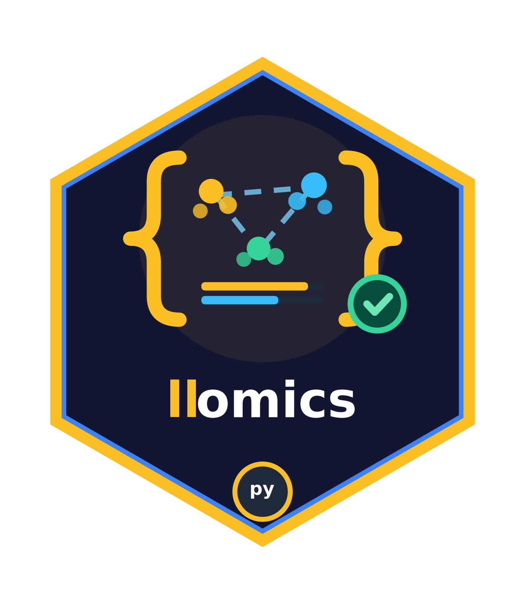

# llomics

<p align="center">
  
</p>

Turn the output of statistical steps in omics pipelines into small, self-describing payloads that
a large language model can reason over, and decide in code what the answers are allowed to settle.

A differential test returns a table with thousands of rows. llomics builds what to send instead:
one small state per contrast or cluster, with the context, the quality checks and the caveats
attached. Hit counts, thresholds and quality checks are computed in code, not left to the model.

- **Try it without installing:** <https://iosinnii.github.io/llomics/> runs this package in the
  browser.
- **Source, R package, skills and benchmark:** <https://github.com/IOsinnii/llomics>

## Install

```bash
pip install llomics            # the core: standard library only
pip install "llomics[scanpy]"  # plus the scanpy adapter
```

## Use

Wrap the scanpy call you already make:

```python
import llomics

payload = llomics.rank_genes_groups(
    adata, "leiden", method="wilcoxon",          # passed on to sc.tl.rank_genes_groups
    n_features=15,                               # markers loaded per cluster; never padded
    panel=["CD3D", "MS4A1", "LYZ"],              # reported for every cluster, null if not measured
    question="Which PBMC population is each cluster?",
    sample_key="donor", batch_key="run",         # feed the trust checks
    out="outputs/markers.llomics.json",
)
```

Or build from any differential table (DESeq2, edgeR, limma, your own test) with the columns
`feature`, `effect`, `p`, `p_adj`, and optionally `symbol`, `stat`, `ave_expr`:

```python
payload = llomics.dge_payload(
    {"treated_vs_control": table},               # one table per contrast, as columns
    {"treated_vs_control": "treated - control; positive effect = higher in treated"},
    analysis_id="my-study", question="Which genes respond to treatment?",
    tool="DESeq2 1.46", steps=["DESeq", "results(alpha = 0.05)"],
    n_observations=12, group_sizes={"treated": 6, "control": 6},
    mean_variance="negative binomial",
)
llomics.write_payload(payload, "outputs/my-study.llomics.json")
```

Check a payload against the contract:

```bash
llomics-validate outputs/my-study.llomics.json
```

## What the payload adds in code

- **Trust checks:** replicates per group, the shape of the p-value histogram, group-by-batch
  confounding, multiple-testing scope, pseudoreplication for cell-level tests. A check that could
  not be computed is written as `not_run`, never left out.
- **Technical panels:** sex, stress, cell cycle, haemoglobin, mitochondrial and ribosomal genes,
  scored against all significant features.
- **Enrichment** against a GMT file you supply, and **comparisons to the dataset** for each cluster.

Asking a model and gating its answers is done by a separate script in the repository,
`skills/llomics-judge/scripts/judge_bedrock.py`; it is not part of this package yet.

## Status

Version 0.1, alpha. The payload format is the llomics contract, version 0.1. See the
[changelog](https://github.com/IOsinnii/llomics/blob/main/CHANGELOG.md) and the
[known gaps](https://github.com/IOsinnii/llomics#known-gaps).

MIT licence. Author and maintainer: Ivan Osinnii.
